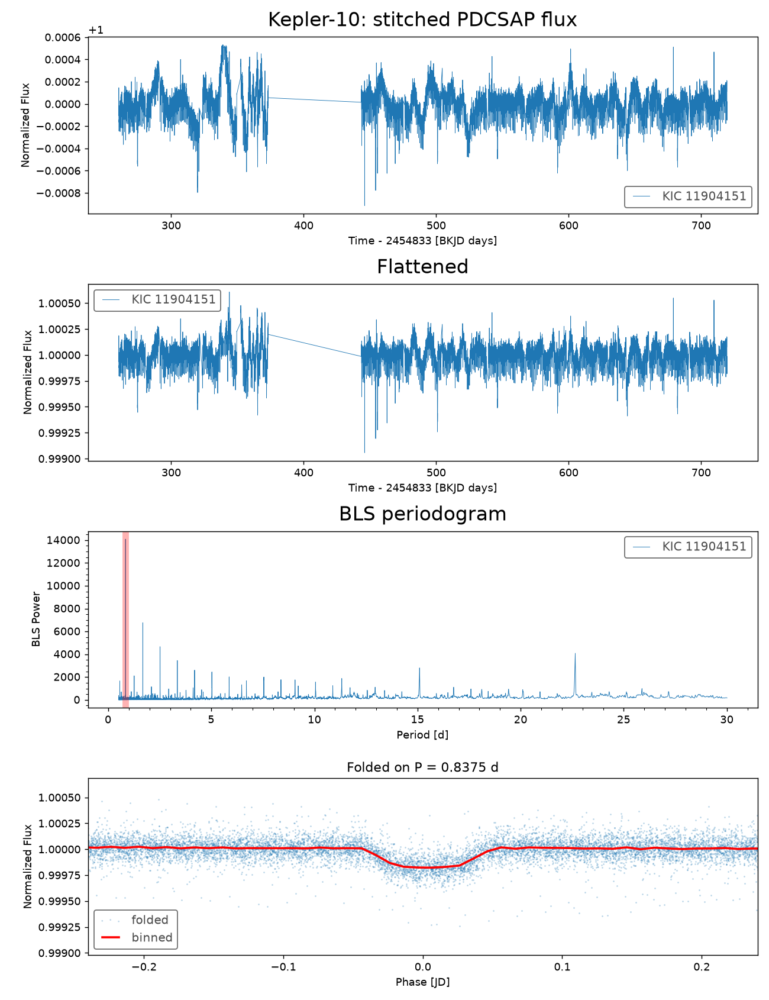
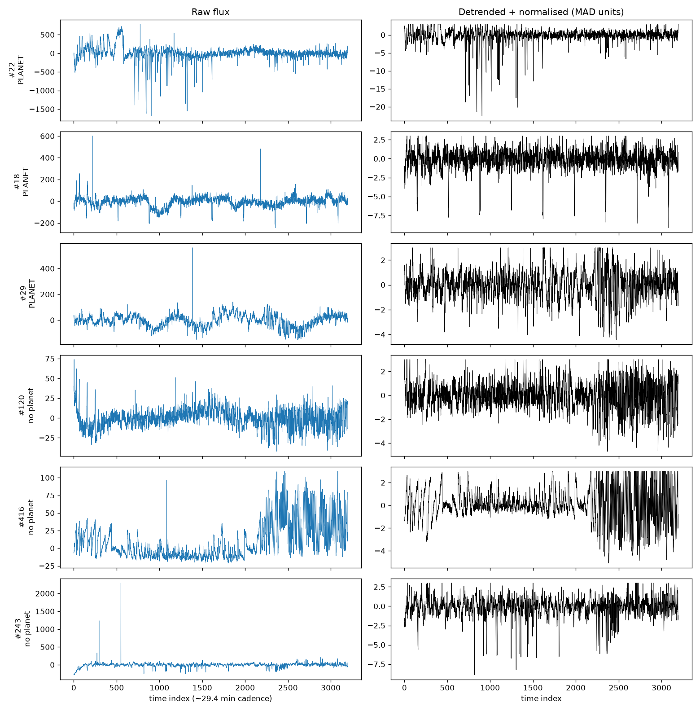
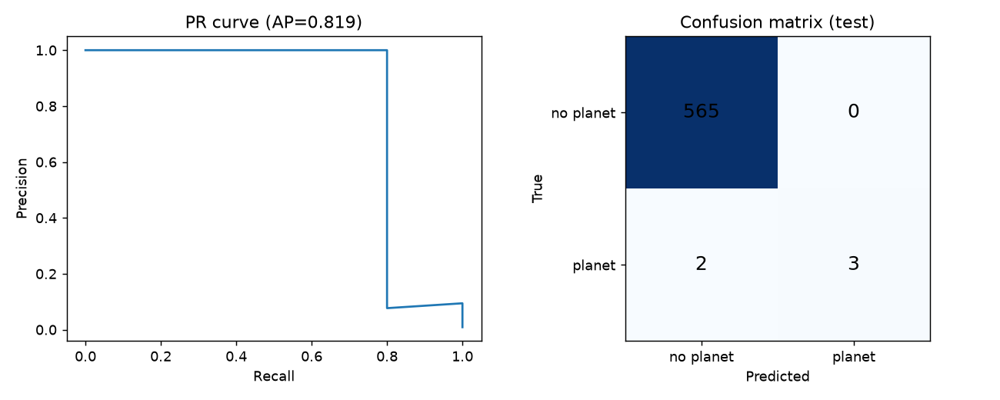
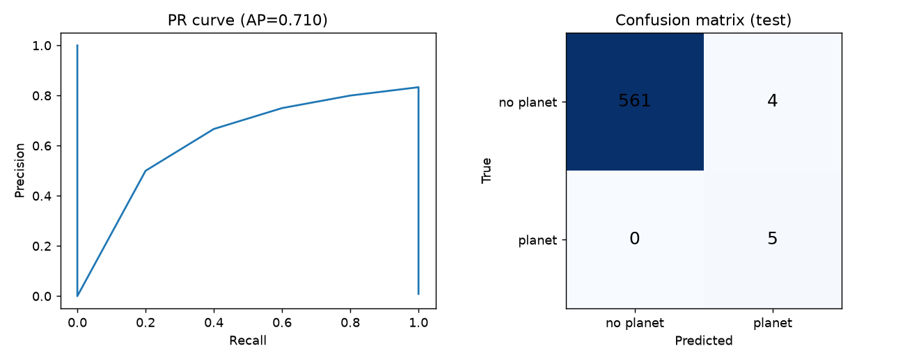
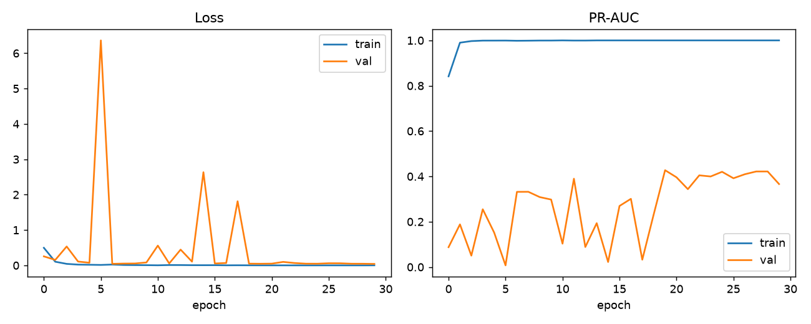

# Exoplanet Hunting in Kepler Light Curves

Find stars that host exoplanets by detecting **transits**: small periodic dips in a star's brightness
as a planet passes in front of it. The project compares a feature-based **Random Forest** with a
**1D CNN** on NASA Kepler data, and uses **Lightkurve** to run the full detection on real Kepler
targets (download → detrend → BLS periodogram → phase-fold).


*Kepler-10b recovered from raw Kepler photometry: P = 0.8375 d, depth ≈ 150 ppm.*

## Data
[Exoplanet Hunting in Deep Space (Kaggle)](https://www.kaggle.com/datasets/keplersmachines/kepler-labelled-time-series-data)

| split | stars | planet hosts | flux points / star |
|---|---|---|---|
| exoTrain.csv | 5087 | 37 | 3197 |
| exoTest.csv | 570 | 5 | 3197 |

`LABEL = 2` → planet host, `1` → no planet. The classes are **very imbalanced (~1 : 136)**, so
accuracy means little: a model that always says "no planet" scores 99.1%. I report **recall,
precision, F1 and PR-AUC** instead.


*Raw flux (left) and detrended, normalised flux (right) for three planet hosts and three non-hosts.*

## Method
**Preprocessing** (`src/common.py`, run separately on each star)
1. Detrend: subtract a 101-point running median. This removes slow stellar variability and
   instrument drift but keeps short transit dips.
2. Clip upward outliers only (flares, cosmic rays). Transits are dips, so the bottom is kept.
3. Robust normalisation by the median absolute deviation (MAD).

**Random Forest** (`src/train_rf.py`)
- Features: a log-scaled FFT magnitude spectrum binned to 400 values (periodic transits appear as
  a comb of harmonics) plus 11 statistics (min, std, skew, kurtosis, percentiles, count of >3σ dips).
- 500 trees with `class_weight="balanced_subsample"`.
- The decision threshold is chosen from 5-fold out-of-fold predictions on **train** only. The test
  set is used once, for the final evaluation.

**1D CNN** (`src/train_cnn.py`, Keras `Conv1D`)
- 5 blocks of Conv1D → BatchNorm → ReLU → MaxPool, then global max + average pooling, dropout and
  a sigmoid output.
- Imbalance handling: **balanced mini-batches**, with the planet stars augmented by random circular
  time shifts and time reversal (a transit is still a transit after either one).
- Early stopping on validation PR-AUC. The validation set is a stratified 20% of train, and the
  threshold is tuned on it.

**Lightkurve case study** (`src/lightkurve_explore.py`)
Downloads a real Kepler light curve from MAST (e.g. Kepler-10), stitches the quarters, flattens it,
runs a Box Least Squares periodogram to recover the orbital period, and phase-folds the transit.

## Results
All numbers are **mean ± std over 5 random seeds** (`src/multi_seed.py`). Decision thresholds are
tuned on train (RF: 5-fold CV) or validation (CNN), never on the test set.

| model | CV / val recall | CV / val PR-AUC | test recall | test precision | test F1 | test PR-AUC |
|---|---|---|---|---|---|---|
| Random Forest (FFT + stats) | 0.60 ± 0.04 | 0.68 ± 0.00 | 0.68 ± 0.11 | 0.96 ± 0.09 | 0.79 ± 0.06 | 0.82 ± 0.02 |
| 1D CNN (single model) | 0.77 ± 0.08 | 0.50 ± 0.10 | 0.92 ± 0.11 | 0.80 ± 0.05 | 0.85 ± 0.06 | 0.71 ± 0.00 |
| **1D CNN ensemble (5 seeds averaged)** | 0.86 | 0.69 | **1.00 (5/5)** | 0.83 (1 FP) | 0.91 | 0.71 |

Test set: 570 stars, 5 planet hosts.

**Findings**
- **The Random Forest is precise but misses planets.** It finds 3–4 of the 5 test planets with almost
  no false alarms. 90% of its feature importance is in the FFT features, so periodicity is its main cue.
- **The CNN is more sensitive.** On average it finds 4.6 of the 5 test planets, with 1–2 false alarms
  among 565 non-planet stars.
- **Ensembling stabilises the CNN.** A single CNN's validation PR-AUC varies from 0.37 to 0.62
  depending on the seed. Averaging the 5 models raises it to 0.69, and the ensemble finds all 5 test
  planets with 1 false alarm.
- **Every CNN ranks the same non-planet star highest.** The test PR-AUC is identically 0.71 for every
  seed: the top-scoring test star is a non-planet, followed by all 5 planets. That star probably has a
  transit-like dip, for example an eclipsing binary or an instrumental artefact, and is worth
  inspecting.
- **Real data:** the Lightkurve pipeline recovers **Kepler-10b** from raw Kepler photometry, with a
  period of 0.8375 d and a transit depth of about 150 ppm, matching the published values.

> With only 5 test positives, recall moves in steps of 0.2. That is why results are reported as
> mean ± std over seeds rather than from a single run.

Full per-seed numbers: [`figures/multi_seed_results.csv`](figures/multi_seed_results.csv)

| Random Forest (test, seed 42) | 1D CNN (test, single run) |
|---|---|
|  |  |


*CNN training curves: training PR-AUC reaches 1.0 while validation stays near 0.4, which is clear
overfitting with only 30 training planets. This motivated the 5-seed ensemble.*

## Project structure
```
exoplanet_hunting.ipynb   run everything from Jupyter
src/common.py             loading, cleaning, features, metrics
src/train_rf.py           Random Forest
src/train_cnn.py          1D CNN
src/multi_seed.py         5-seed evaluation + CNN ensemble
src/lightkurve_explore.py real Kepler data: BLS period search + phase fold
src/plot_examples.py      example light curves figure
scripts/make_synthetic.py fake data for smoke tests
figures/                  result figures used in this README
```

## Run it
```bash
pip install -r requirements.txt
# put exoTrain.csv and exoTest.csv in ./data  (kaggle datasets download -d keplersmachines/kepler-labelled-time-series-data)
python src/plot_examples.py
python src/train_rf.py
python src/train_cnn.py --epochs 40
python src/multi_seed.py --seeds 0 1 2 3 4   # mean ± std + CNN ensemble
python src/lightkurve_explore.py --target "Kepler-10" --quarters 3 4 5 6 7
```
Or open `exoplanet_hunting.ipynb` in Jupyter and run the cells top to bottom.
To smoke-test without the real data:
`python scripts/make_synthetic.py data_synth && EXO_DATA_DIR=data_synth python src/train_rf.py`

## Possible extensions
- Phase-folded "global / local view" inputs, as in Shallue & Vanderburg (2018, AstroNet).
- Extract BLS period, depth and SNR per star as extra Random Forest features.
- Gradient boosting (LightGBM/XGBoost) and an ensemble of the RF and CNN.
- Run the trained CNN on new Kepler/TESS light curves fetched with Lightkurve.
